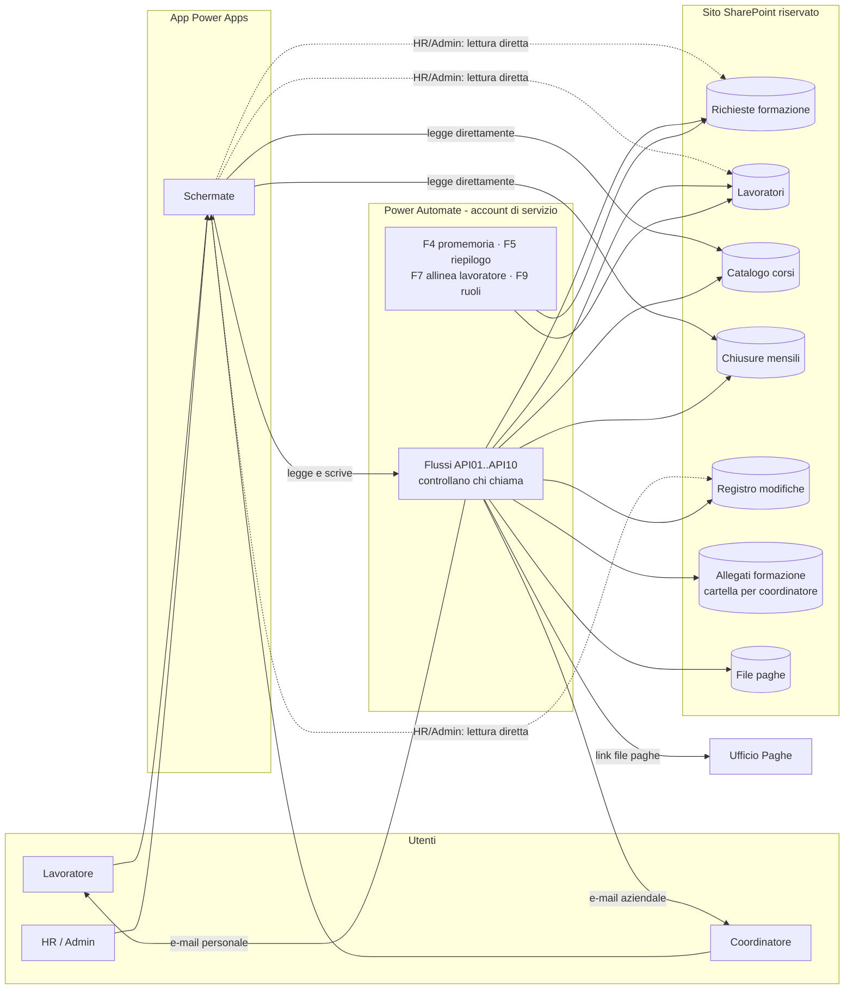
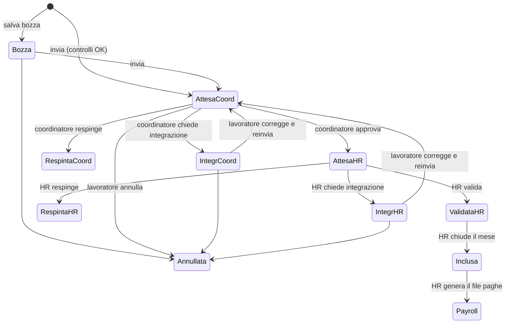

# 1. Architettura della soluzione

> Soluzione **"Gestione ore formazione"** per Società Dolce. Sostituisce il foglio cartaceo delle ore di formazione con un processo digitale
> **Lavoratore → Coordinatore → Ufficio HR/Formazione → Ufficio Paghe**,
> usando **solo strumenti inclusi nelle licenze Microsoft 365 di base**: nessuna licenza premium, nessun pagamento a consumo.

## 1.1 Vincoli e scelte di fondo

| Vincolo | Conseguenza |
|---|---|
| La maggior parte dei lavoratori ha una licenza Microsoft 365 di base (accesso a intranet/SharePoint, nessuna casella di posta aziendale) | Niente Dataverse e niente connettori premium. Dati su **liste SharePoint**, app **Power Apps Canvas** e flussi **Power Automate** con soli connettori *standard* (SharePoint, Office 365 Outlook, Office 365 Utenti) |
| Nessuna spesa aggiuntiva | Si usano i diritti d'uso di Power Apps e Power Automate inclusi in Microsoft 365. L'app gira nell'ambiente predefinito del tenant |
| I lavoratori non hanno l'e-mail aziendale | Al **primo accesso** ogni lavoratore deve inserire la propria **e-mail personale** nel profilo: lì riceve tutte le notifiche |
| I coordinatori hanno l'e-mail aziendale | Le notifiche ai coordinatori vanno all'**e-mail associata all'account Microsoft** |
| Sicurezza come da requisiti (ognuno vede solo ciò che gli spetta) | SharePoint non ha la sicurezza per riga e per colonna di Dataverse. Per questo lavoratori e coordinatori **non hanno accesso diretto** alle richieste: leggono e scrivono tramite **flussi API** eseguiti da un account di servizio, che verificano l'identità di chi chiama |

## 1.2 Componenti

| Componente | Tecnologia | Nel repository |
|---|---|---|
| Archivio | Sito SharePoint dedicato **"Gestione ore formazione"** con 8 liste e 2 raccolte documenti | `sharepoint/schema.yaml`, modello PnP generato in `sharepoint/template/`, script `sharepoint/Installa-GestioneFormazione.ps1` |
| App | Power Apps **Canvas** responsive (PC, tablet, smartphone), pubblicabile anche nella intranet con la web part Power Apps | `powerapps/` |
| Logica e sicurezza | 10 **flussi API** (trigger Power Apps) + 5 flussi automatici | `powerautomate/` |
| File paghe | CSV mensile nella raccolta **File paghe** | flusso API09 |

## 1.3 Chi accede a cosa

| | Lavoratore | Coordinatore | Formazione HR | Amministratore | Account di servizio |
|---|---|---|---|---|---|
| Richieste formazione | tramite API02/03/10 (solo le proprie) | tramite API05/06/10 (solo il proprio team) | **lettura diretta** di tutte; scritture tramite API07/08/09 | come HR | controllo completo |
| Lavoratori | tramite API01/04 (solo il proprio) | — | lettura e **modifica diretta** | modifica diretta | controllo completo |
| Strutture organizzative, Ruoli applicativi, Configurazione | — | — | lettura | modifica diretta | controllo completo |
| Catalogo corsi | **lettura diretta** | lettura diretta | lettura | modifica diretta | controllo completo |
| Chiusure mensili | **lettura diretta** | lettura diretta | lettura; scrittura tramite API08 | come HR + riapertura | controllo completo |
| Registro modifiche | — | — | lettura | lettura e scrittura | controllo completo |
| Allegati formazione | caricamento tramite API03 | **lettura della propria cartella** | lettura | controllo completo | controllo completo |
| File paghe | — | — | lettura | controllo completo | controllo completo |

Per ottenere questi permessi si usano:
- **Proprietari del sito**: amministratori applicativi e account di servizio;
- gruppo **Formazione - HR**: lettura del sito, modifica della lista Lavoratori;
- gruppo **Formazione - Paghe**: lettura della sola raccolta File paghe;
- **"Tutti tranne gli utenti esterni"**: lettura delle sole liste Catalogo corsi e Chiusure mensili;
- **cartella per coordinatore** in *Allegati formazione*, condivisa in lettura con il coordinatore dal flusso API03.

## 1.4 Ruoli applicativi

| Ruolo | Come viene riconosciuto (flusso API01) | Chi lo gestisce |
|---|---|---|
| **Lavoratore** | esiste un elemento *Lavoratori* con `Login` = account dell'utente e *Stato lavoratore* = Attivo | Amministratore / HR (lista Lavoratori) |
| **Coordinatore** | almeno un lavoratore attivo ha `Login coordinatore` = account dell'utente | Amministratore: nasce dall'assegnazione dei lavoratori al coordinatore |
| **Formazione HR** | elemento attivo in *Ruoli applicativi* con Ruolo = Formazione HR | Amministratore (schermata Amministrazione); il flusso F9 aggiunge la persona al gruppo *Formazione - HR* |
| **Amministratore** | elemento attivo in *Ruoli applicativi* con Ruolo = Amministratore | Amministratore; F9 aggiunge la persona ai Proprietari del sito |

Un utente può avere più ruoli: un coordinatore è spesso anche lavoratore. L'app mostra il ruolo più alto (Amministratore > Formazione HR > Coordinatore > Lavoratore) e abilita le funzioni di tutti i ruoli posseduti.

## 1.5 Ciclo di vita della richiesta

| Stato | Chi lo imposta | Colore |
|---|---|---|
| Bozza | Lavoratore ("Salva bozza") | grigio |
| Inviata al coordinatore | stato transitorio dentro API03 | blu |
| In attesa del coordinatore | API03 dopo i controlli dell'invio | blu |
| Integrazione richiesta dal coordinatore | Coordinatore (API06, nota obbligatoria) | arancione |
| Respinta dal coordinatore | Coordinatore (API06, motivazione obbligatoria) | rosso |
| Approvata dal coordinatore | stato transitorio dentro API06 | verde |
| In attesa di validazione HR | API06 dopo l'approvazione | viola |
| Integrazione richiesta da HR | HR (API07, nota obbligatoria) | arancione |
| Respinta da HR | HR (API07, motivazione obbligatoria) | rosso |
| Validata da HR | HR (API07) | verde scuro |
| Inclusa nel riepilogo mensile | API08 alla chiusura del mese | petrolio |
| Inviata a Payroll | API09 alla generazione del file paghe | blu scuro |
| Annullata | Lavoratore (API03, azione "annulla") | grigio scuro |

"Inviata al coordinatore" e "Approvata dal coordinatore" esistono come stati, come da requisiti, ma i flussi li attraversano nella stessa esecuzione: la richiesta passa subito allo stato di attesa successivo. Il registro conserva entrambi i passaggi.

**Regole di modifica (verificate dai flussi, non solo dall'app)**

| Azione | Consentita se |
|---|---|
| Lavoratore modifica / reinvia | stato Bozza, Integrazione richiesta dal coordinatore, Integrazione richiesta da HR |
| Lavoratore annulla | stato Bozza, In attesa del coordinatore, Integrazione richiesta dal coordinatore, Integrazione richiesta da HR |
| Coordinatore approva / respinge / chiede integrazione | stato In attesa del coordinatore; chi chiama = coordinatore della richiesta e **diverso** dal lavoratore |
| HR valida / respinge / chiede integrazione | stato In attesa di validazione HR; chi chiama ha ruolo HR o Amministratore e **non** è il lavoratore |
| Qualsiasi modifica | mai se lo stato è Validata da HR o successivo, oppure se il **mese di competenza è Chiuso** |
| Riapertura di un mese | solo Amministratore, con motivazione |

## 1.6 Regole e controlli

| # | Regola | App | Flusso |
|---|---|---|---|
| R1 | Ora fine sessione > ora inizio; ora uscita > ora ingresso (formato HH:mm) | blocca | API03 blocca |
| R2 | Durata sessione = fine − inizio; ore frequentate = uscita − ingresso; ore frequentate ≤ durata sessione | calcola, blocca | API03 ricalcola |
| R3 | Ore retribuite richieste + ore gettone richieste ≤ ore frequentate; valori ≥ 0 | blocca | API03 blocca |
| R4 | Ore riconosciute (coordinatore o HR, retribuite + gettone) ≤ ore frequentate; valori ≥ 0 | blocca | API06 / API07 bloccano |
| R5 | Corso a catalogo con *Gettone previsto* = No: ore gettone = 0 | campo disabilitato | API03 forza 0 |
| R6 | Somma delle durate di sessione dello stesso lavoratore sullo stesso codice corso ≤ durata complessiva del corso | avviso | API03 blocca se supera; segnala in *Anomalie* se a fine mese non coincide |
| R7 | Duplicato: stesso lavoratore + stesso codice corso + stessa data (escluse annullate e respinte) | avviso con conferma | API03 imposta *Possibile duplicato* su entrambe e avvisa coordinatore e HR |
| R8 | Nessuna modifica dopo *Validata da HR* | sola lettura | tutti i flussi API |
| R9 | Nessuna nuova richiesta o modifica con data in un mese **Chiuso** | blocca | API03 / 06 / 07 bloccano |
| R10 | Ogni azione è registrata in *Registro modifiche* (chi, ruolo, campo, prima/dopo); in più il controllo versioni di SharePoint | — | tutti i flussi |
| R11 | Per inviare: corso (catalogo o titolo libero), data, 4 orari, ore richieste > 0, 3 dichiarazioni, coordinatore assegnato, e-mail personale presente | blocca | API03 blocca |
| R12 | Mese e anno di competenza = mese e anno della data della sessione | — | API03 calcola |

## 1.7 Schermate dell'app

| # | Schermata | Nome | Ruoli |
|---|---|---|---|
| 0 | Accesso / benvenuto | `scrAccesso` | tutti |
| 0b | Il mio profilo (obbligatoria al primo accesso: e-mail personale e codice fiscale) | `scrProfilo` | lavoratore |
| 1 | Home page (contenuto per ruolo) | `scrHome` | tutti |
| 2 | Le mie richieste | `scrMieRichieste` | lavoratore |
| 3 | Nuova richiesta / modifica | `scrRichiesta` | lavoratore |
| 4 | Richieste del team | `scrTeam` | coordinatore |
| 5 | Dettaglio e approvazione | `scrDettaglio` | lavoratore (lettura), coordinatore, HR |
| 6 | Validazione HR (singola e per perimetro) | `scrValidazioneHR` | HR |
| 7 | Riepilogo mensile | `scrRiepilogo` | coordinatore (proprio gruppo), HR (tutto) |
| 8 | Chiusura mensile e file paghe | `scrChiusura` | HR, amministratore (riapertura) |
| 9 | Amministrazione (lavoratori, organigramma, catalogo, ruoli, configurazione) | `scrAdmin` | amministratore |

**Schermata 0 (Login).** Power Apps non permette, e non sarebbe sicuro, chiedere nome utente e password dentro l'app. L'accesso avviene con l'account **Microsoft 365** (Single Sign-On), lo stesso usato per la intranet, prima che l'app si apra. La schermata 0 mostra l'utente collegato, carica il profilo (API01) e riporta il link **"Hai dimenticato la password?"** → https://password.societadolce.it/.

**Primo accesso del lavoratore.** Se manca l'e-mail personale o il codice fiscale, l'app porta il lavoratore su `scrProfilo` e non lo lascia proseguire finché non li inserisce.

**Collegamento diretto.** Le e-mail contengono `‹URL app›&richiesta=‹ID elemento›`; l'app legge `Param("richiesta")` e apre `scrDettaglio` tramite API10.

## 1.8 Flussi Power Automate

Tutti i flussi usano connessioni create con l'**account di servizio** (es. `svc-formazione@societadolce.it`), che è proprietario del sito. I flussi API hanno trigger *Power Apps (V2)*, ricavano l'identità di chi chiama dall'intestazione della chiamata (`x-ms-user-email`), mai da un parametro, e rispondono con `esito`, `messaggio`, `dati`. Il contratto completo è in [06-api-flussi.md](06-api-flussi.md).

| Flusso | Trigger | Funzione |
|---|---|---|
| **SDF_API01_Profilo** | Power Apps | Ruoli dell'utente, dati del lavoratore, stato del profilo |
| **SDF_API02_MieRichieste** | Power Apps | Richieste del lavoratore chiamante |
| **SDF_API03_SalvaRichiesta** | Power Apps | Salva bozza, invia al coordinatore (requisito *Flusso 1*), annulla. Valida le regole, crea il corso esterno, carica gli allegati nella cartella del coordinatore, controlla duplicati e somma delle sessioni, scrive il registro, notifica il coordinatore con il collegamento diretto |
| **SDF_API04_AggiornaProfilo** | Power Apps | E-mail personale, codice fiscale (salvato in chiaro solo nella lista Lavoratori, visibile solo a HR), segnalazione di variazione a HR |
| **SDF_API05_RichiesteTeam** | Power Apps | Richieste e lavoratori del team del coordinatore chiamante |
| **SDF_API06_EsitoCoordinatore** | Power Apps | Approva / respinge / chiede integrazione (requisito *Flusso 2*), notifica il lavoratore sull'e-mail personale |
| **SDF_API07_EsitoHR** | Power Apps | Valida / respinge / chiede integrazione su una o più richieste (requisito *Flusso 3*), notifica lavoratore e coordinatore |
| **SDF_API08_ChiusuraMensile** | Power Apps | HR chiude il mese (le validate diventano "Inclusa nel riepilogo mensile"); l'Amministratore lo riapre |
| **SDF_API09_FilePaghe** | Power Apps | Genera il CSV del mese (requisito *Flusso 6*), lo salva in *File paghe*, porta le richieste a "Inviata a Payroll", invia il link ai destinatari |
| **SDF_API10_DettaglioRichiesta** | Power Apps | Dettaglio di una richiesta con i permessi calcolati per chi chiama e, per HR, lo storico |
| **SDF_F4_Promemoria** | Ricorrenza lun–ven 08:00 | Requisito *Flusso 4*: promemoria al coordinatore dopo 3 e 5 giorni lavorativi, segnalazione a HR dopo 7 (festività dalla lista Configurazione) |
| **SDF_F5_RiepilogoMensile** | Ricorrenza giorno 2 del mese, 07:00 | Requisito *Flusso 5*: riepilogo del mese precedente a ogni coordinatore e quadro completo a HR, con aperte, respinte e incomplete evidenziate |
| **SDF_F7_AllineaLavoratore** | Lavoratori: elemento creato o modificato | Completa login, nome ed e-mail di lavoratore e coordinatore; se cambia il coordinatore, aggiorna le richieste aperte, sposta gli allegati nella nuova cartella e avvisa il nuovo coordinatore |
| **SDF_F9_SincronizzaRuoli** + **SDF_F9b_RuoloEliminato** | Ruoli applicativi: elemento creato o modificato / eliminato | Aggiunge o toglie le persone dal gruppo *Formazione - HR* e dai Proprietari del sito |

## 1.9 Limiti noti della soluzione a costo zero

| Tema | Limite | Mitigazione |
|---|---|---|
| Velocità | Le schermate del lavoratore e del coordinatore leggono e scrivono tramite flussi: ogni salvataggio o caricamento richiede circa 2–5 secondi | Indicatore di caricamento; dati tenuti in memoria nell'app durante la sessione |
| Limite richieste Power Platform | Con licenza Microsoft 365 ogni utente ha un numero limitato di azioni di flusso al giorno (attualmente 6.000 ogni 24 ore) | Ampiamente sufficiente per l'uso normale. La chiusura del mese e il file paghe aggiornano un elemento per richiesta: oltre ~2.000 richieste al mese conviene chiudere per area |
| Volumi nell'app HR | Le funzioni di aggregazione su SharePoint lavorano su massimo 2.000 righe per filtro | Filtrare per mese e perimetro; per analisi pluriennali usare Excel o Power BI Desktop collegati alla lista |
| Soglia di visualizzazione SharePoint (5.000 elementi) | Le liste cresceranno oltre 5.000 elementi | Colonne indicizzate (anno, mese, stato, login, centro di costo) e filtri sempre su colonne indicizzate |
| Integrità | Proprietari del sito e HR (sulla lista Lavoratori) possono modificare direttamente da SharePoint | Sono utenti di fiducia; il controllo versioni registra ogni modifica |

## 1.10 Punti aperti da confermare con Società Dolce

| Tema | Scelta adottata |
|---|---|
| Ore richieste vs frequentate | Il vincolo vale sulla **somma** di ore retribuite e ore gettone |
| "Gettone" | Espresso in **ore** gettone. Per un valore in euro si può aggiungere una tariffa oraria al catalogo |
| Pause durante la sessione | Non previste: ore frequentate = uscita − ingresso |
| Correzione dopo un'integrazione richiesta da HR | La richiesta torna al coordinatore |
| Richieste ancora aperte alla chiusura del mese | HR le vede e conferma la chiusura; poi restano bloccate finché l'Amministratore non riapre il mese |
| Corsi esterni "da storico" | Quelli inseriti dallo stesso lavoratore con *Più giornate formative* = Sì |
| Tracciato del file paghe | CSV con separatore `;`, si apre in Excel; verificare con il software paghe |
| Allegati delle bozze | Finiscono già nella cartella del coordinatore assegnato. Se non va bene, si possono spostare al momento dell'invio |
