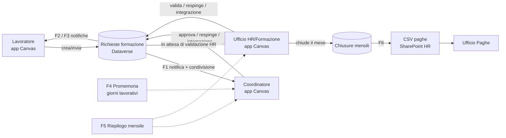
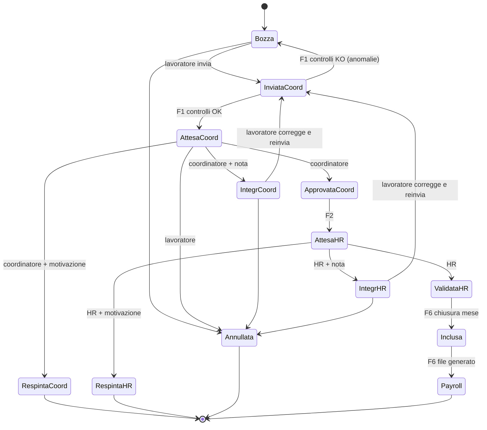

# 1. Architettura della soluzione

> Soluzione **"Gestione ore formazione"** per Società Dolce: sostituisce il foglio cartaceo delle ore di formazione con un processo digitale
> **Lavoratore → Coordinatore → Ufficio HR/Formazione → Ufficio Paghe**.

## 1.1 Componenti

| Componente | Tecnologia | Contenuto nel repository |
|---|---|---|
| App per gli utenti | Power Apps **Canvas** responsive | `powerapps/` (formule Power Fx e schermate in formato YAML `.pa.yaml`) |
| Archivio dati | **Dataverse** (6 tabelle, 9 scelte globali) | `dataverse/schema.yaml` + `dataverse/provision.py` |
| Automazioni | **Power Automate** (8 flussi cloud nella soluzione) | `powerautomate/flows/*.json` |
| Sicurezza | Ruoli di sicurezza Dataverse, team di gruppo Entra ID, sicurezza a livello di colonna, condivisione dei record | `dataverse/schema.yaml` (sezioni `security_roles`, `column_security_profiles`, `teams`) |
| File paghe | CSV su raccolta documentale SharePoint HR | Flusso F6 |

Tutti i componenti stanno nella soluzione Dataverse **`GestioneOreFormazione`** (publisher `societadolce`, prefisso `sdf_`), così si possono spostare da sviluppo a test a produzione come pacchetto gestito.



## 1.2 Ruoli applicativi

| Ruolo | Come viene riconosciuto dall'app | Sicurezza Dataverse |
|---|---|---|
| **Lavoratore** | esiste un record in *Lavoratori* con `Login Microsoft 365` = UPN dell'utente | team `SDF Lavoratori` → ruolo `SDF - Lavoratore` (accesso **Utente**: solo i propri record) |
| **Coordinatore** | almeno un lavoratore ha `Login coordinatore` = UPN dell'utente | team `SDF Coordinatori` → stesso ruolo del lavoratore + profilo colonne `SDF - Coordinatori`. Vede le richieste del team perché il flusso F1 gliele **condivide** |
| **Formazione HR** | l'utente può creare record in *Chiusure mensili* (`DataSourceInfo(..., CreatePermission)`) | team `SDF Formazione HR` → ruolo `SDF - Formazione HR` (lettura/scrittura **Organizzazione**) |
| **Amministratore** | l'utente può creare record in *Strutture organizzative* | team `SDF Amministratori` → ruoli `SDF - Amministratore` + `SDF - Formazione HR` |

Un utente può avere più ruoli (es. un coordinatore è anche lavoratore). L'app mostra il ruolo "più alto" (Amministratore > Formazione HR > Coordinatore > Lavoratore) e abilita le funzioni di tutti i ruoli posseduti.

**Chi decide i ruoli:** i ruoli HR e Amministratore si gestiscono aggiungendo le persone ai gruppi Entra ID collegati ai team. Il ruolo Coordinatore nasce invece dall'assegnazione: quando l'amministratore associa un lavoratore a un coordinatore, il coordinatore lo diventa (va inserito anche nel gruppo Entra "Coordinatori" per il profilo colonne).

## 1.3 Ciclo di vita della richiesta (macchina a stati)

| Valore | Stato | Chi lo imposta | Colore |
|---|---|---|---|
| 741500000 | Bozza | Lavoratore (default alla creazione) | grigio |
| 741500001 | Inviata al coordinatore | Lavoratore (pulsante "Invia al coordinatore") | blu |
| 741500002 | In attesa del coordinatore | Flusso F1 dopo i controlli | blu |
| 741500003 | Integrazione richiesta dal coordinatore | Coordinatore | arancione |
| 741500004 | Respinta dal coordinatore | Coordinatore (motivazione obbligatoria) | rosso |
| 741500005 | Approvata dal coordinatore | Coordinatore | verde |
| 741500006 | In attesa di validazione HR | Flusso F2 | viola |
| 741500007 | Integrazione richiesta da HR | HR | arancione |
| 741500008 | Respinta da HR | HR (motivazione obbligatoria) | rosso |
| 741500009 | Validata da HR | HR | verde scuro |
| 741500010 | Inclusa nel riepilogo mensile | Flusso F6 alla chiusura del mese | petrolio |
| 741500011 | Inviata a Payroll | Flusso F6 dopo la generazione del file | blu scuro |
| 741500012 | Annullata | Lavoratore | grigio scuro |



**Regole di modifica**

| Chi | Può modificare la richiesta quando lo stato è | Può annullare quando lo stato è |
|---|---|---|
| Lavoratore | Bozza, Integrazione richiesta dal coordinatore, Integrazione richiesta da HR | Bozza, Inviata al coordinatore, In attesa del coordinatore, Integrazione richiesta dal coordinatore, Integrazione richiesta da HR |
| Coordinatore | Inviata al coordinatore, In attesa del coordinatore (solo ore riconosciute coordinatore e note) | — |
| HR | Approvata dal coordinatore, In attesa di validazione HR (solo ore approvate HR e note) | — |
| Tutti | **mai** se lo stato è Validata da HR o successivo, oppure se il mese di competenza è **Chiuso** | — |

Dopo un'integrazione richiesta da HR, il lavoratore reinvia e la richiesta riparte dal coordinatore, che deve riverificare le ore se i dati sono cambiati.

## 1.4 Regole e controlli

| # | Regola | Dove |
|---|---|---|
| R1 | Ora fine sessione > ora inizio sessione; ora uscita > ora ingresso | App (blocca) |
| R2 | Ore frequentate = (uscita − ingresso) in ore, ≥ 0, ≤ durata sessione | App (calcolo automatico, blocca) |
| R3 | Ore retribuite richieste + ore gettone richieste ≤ ore frequentate | App (blocca) |
| R4 | Ore riconosciute (coordinatore o HR, retribuite + gettone) ≤ ore frequentate | App (blocca) |
| R5 | Ore gettone ≥ 0; se il corso a catalogo ha *Gettone previsto = No* il campo è disabilitato e vale 0 | App |
| R6 | Somma delle durate di sessione dello stesso lavoratore per lo stesso codice corso ≤ durata complessiva del corso (deve coincidere a corso concluso) | App (blocca se supera), F1 (segnala anomalia se diversa) |
| R7 | Duplicato = stesso lavoratore + stesso codice corso + stessa data sessione (escluse Annullate/Respinte) | App (avviso prima dell'invio), F1 (marca *Possibile duplicato* e avvisa coordinatore e HR) |
| R8 | Nessuna modifica dopo *Validata da HR* | App + F2/F3 (controllo integrità) |
| R9 | Nessuna modifica né nuova richiesta con data in un mese **Chiuso** | App |
| R10 | Ogni variazione di coordinatore, HR e amministratore è scritta in *Registro modifiche*; inoltre è attivo il controllo (audit) Dataverse | App + flussi + audit |
| R11 | Campi obbligatori per l'invio: corso (catalogo o titolo libero), codice corso, data, orari sessione, orari ingresso/uscita, ore richieste > 0, 3 dichiarazioni spuntate, coordinatore presente | App (blocca), F1 (riverifica: se mancano torna in Bozza con anomalia) |
| R12 | Mese/anno di competenza = mese/anno della data della sessione | App |

## 1.5 Schermate dell'app Canvas

| # | Schermata | Nome controllo | Ruoli |
|---|---|---|---|
| 0 | Accesso / benvenuto | `scrAccesso` | tutti |
| 1 | Home page (contenuto per ruolo) | `scrHome` | tutti |
| 2 | Le mie richieste | `scrMieRichieste` | lavoratore |
| 3 | Nuova richiesta / modifica | `scrRichiesta` | lavoratore |
| 4 | Richieste del team | `scrTeam` | coordinatore |
| 5 | Dettaglio e approvazione | `scrDettaglio` | lavoratore (sola lettura), coordinatore, HR |
| 6 | Validazione HR (singola e per perimetro) | `scrValidazioneHR` | HR |
| 7 | Riepilogo mensile | `scrRiepilogo` | coordinatore (proprio gruppo), HR (tutto) |
| 8 | Chiusura mensile e file paghe | `scrChiusura` | HR, amministratore (riapertura) |
| 9 | Amministrazione (lavoratori, organigramma, catalogo, ruoli) | `scrAdmin` | amministratore |

**Nota sulla schermata 0 (Login).** Power Apps non permette, e non sarebbe sicuro, chiedere nome utente e password dentro l'app: l'autenticazione è il **Single Sign-On Microsoft 365 / Entra ID**, che avviene prima dell'apertura dell'app (con eventuale MFA). La schermata 0 è quindi una pagina di benvenuto che mostra l'utente collegato, verifica che sia censito in *Lavoratori* e riporta il collegamento **"Hai dimenticato la password? → https://password.societadolce.it/"**.

**Collegamento diretto.** Le e-mail contengono `‹URL app›&richiesta=‹GUID›`; l'app legge `Param("richiesta")` e apre `scrDettaglio`.

## 1.6 Flussi Power Automate

| Flusso | Trigger | Cosa fa |
|---|---|---|
| **F1 – Invio al coordinatore** | Dataverse: riga *Richieste formazione* modificata, filtro `sdf_stato eq 741500001` | Riverifica i campi obbligatori (se KO: torna in Bozza con anomalie e avvisa il lavoratore). Recupera il coordinatore da *Lavoratori*/*Struttura organizzativa*, imposta "In attesa del coordinatore", data invio, azzera i giorni di attesa, **condivide** il record con il coordinatore (GrantAccess Read/Write/Append/AppendTo), controlla i duplicati (R7) e la somma delle sessioni (R6), registra *Attestato presente*, scrive il registro e invia l'e-mail al coordinatore con collegamento diretto |
| **F2 – Esito coordinatore** | modifica con `sdf_stato` in (741500003, 741500004, 741500005, 741500012) | Controllo integrità (chi ha modificato deve essere il coordinatore assegnato e non il proprietario). Approvata → "In attesa di validazione HR" + notifica al lavoratore. Respinta → notifica con motivazione. Integrazione → notifica con nota. Annullata dopo l'invio → avviso al coordinatore |
| **F3 – Esito HR** | modifica con `sdf_stato` in (741500007, 741500008, 741500009) | Notifica lavoratore e coordinatore con ore definitive, motivazione o nota; scrive il registro |
| **F4 – Promemoria** | Ricorrenza lun–ven ore 08:00 (Europe/Rome) | Esce se oggi è festivo (`sdf_Festivita`). Per ogni richiesta "In attesa del coordinatore" incrementa *Giorni lavorativi in attesa*: a 3 e a 5 invia un promemoria al coordinatore, a 7 segnala anche a HR (*Sollecito segnalato a HR* = Sì) |
| **F5 – Riepilogo mensile** | Ricorrenza mensile, giorno 2 ore 07:00 (entro il 4° giorno) | Richieste del mese precedente raggruppate per coordinatore: e-mail a ogni coordinatore con il proprio gruppo, e-mail a HR con il quadro completo; evidenzia aperte, respinte e incomplete |
| **F6 – Esportazione Payroll** | Modifica di *Chiusure mensili* con `sdf_statoperiodo eq 741500001` (Chiuso) | Prende le richieste del periodo in stato "Validata da HR", le porta a "Inclusa nel riepilogo mensile", genera il CSV (separatore `;`, UTF-8 con BOM per Excel), lo salva nella cartella SharePoint HR, porta le richieste a "Inviata a Payroll", aggiorna totali e collegamento sulla chiusura e invia il link ai destinatari autorizzati |
| **F7 – Allinea lavoratore** | *Lavoratori* creato o modificato (utente, coordinatore, struttura, stato) | Copia area, servizio e centro di costo dalla struttura; compila login, nome ed e-mail del coordinatore dall'utente; condivide il record in lettura con il lavoratore e con il coordinatore; se il coordinatore cambia, condivide con il nuovo coordinatore le richieste ancora aperte |
| **F8 – Aggiorna dati personali** | Power Apps (V2), chiamato dall'app | Aggiorna e-mail di contatto, codice fiscale (colonna protetta) e segnalazione di variazione del lavoratore **che ha chiamato il flusso** (identità dagli header della chiamata, non da parametri). Restituisce il CF mascherato |

I flussi usano i riferimenti di connessione `sdf_ConnDataverse`, `sdf_ConnOutlook`, `sdf_ConnSharePoint` e le variabili d'ambiente `sdf_AppUrl`, `sdf_EmailHR`, `sdf_DestinatariPayroll`, `sdf_SitoSharePointHR`, `sdf_CartellaPayroll`, `sdf_Festivita`.
Le connessioni conviene crearle con un **account di servizio** (es. `svc-formazione@societadolce.it`) con licenza e ruolo *System Administrator* nell'ambiente: le e-mail partono da quell'account, o da una cassetta condivisa, e il flusso F8 può scrivere la colonna protetta del codice fiscale.

## 1.7 Modello di sicurezza (sintesi)

1. **Righe.** Le *Richieste* sono di proprietà del lavoratore che le crea, che con il ruolo `SDF - Lavoratore` vede solo le proprie. Il coordinatore le vede perché F1 gliele **condivide**. HR e amministratori leggono a livello Organizzazione.
2. **Anagrafica.** I record *Lavoratori* sono di proprietà dell'amministratore o del team: il lavoratore non può modificarli e li legge perché F7 glieli condivide in sola lettura. I dati personali (e-mail di contatto, CF) si aggiornano solo tramite F8.
3. **Colonne.** Ore e note del coordinatore, ore e note HR e il **codice fiscale** sono colonne protette:
   - il lavoratore legge gli esiti ma non può scriverli, nemmeno via API;
   - il CF è leggibile solo da HR, dagli amministratori e dall'account di servizio. L'app mostra il CF mascherato.
4. **Allegati.** Sono colonne di tipo *File* sulla richiesta e seguono la sicurezza del record: li vede solo chi vede la richiesta.
5. **Integrità del flusso.** F2 e F3 verificano che le transizioni siano fatte da chi è autorizzato: un coordinatore non può approvare le proprie richieste. Se il controllo fallisce, lo stato torna indietro e HR viene avvisata. Per un controllo bloccante lato server si può aggiungere un plug-in Dataverse (vedi [03-sicurezza.md](03-sicurezza.md)).
6. **Privacy.** I dati sono minimizzati: niente CF sulle richieste; il CF compare solo nel file paghe. Audit Dataverse attivo, conservazione e informativa come da [03-sicurezza.md](03-sicurezza.md).

## 1.8 Convenzioni di nomenclatura (Power Fx)

L'app usa i **nomi visualizzati** di tabelle e colonne definiti in `dataverse/schema.yaml`. Esempi:

```powerfx
'Richieste formazione'                        // tabella
ThisItem.'Stato richiesta'                    // colonna di scelta
'Stati richiesta'.'In attesa del coordinatore' // valore della scelta globale
ThisItem.'Ore retribuite richieste'
'Catalogo corsi', Lavoratori, 'Strutture organizzative', 'Chiusure mensili', 'Registro modifiche'
```

Le scelte globali hanno il nome al plurale (`'Stati richiesta'`, `Aree`, `'Modalità formative'`, `'Tipi ente erogatore'`, `'Stati periodo'`, `'Stati lavoratore'`, `'Origini corso'`, `'Stati validazione corso'`, `'Ruoli applicativi'`) per evitare ambiguità con i nomi delle colonne.

## 1.9 Scelte progettuali e punti aperti

| Tema | Scelta adottata | Da confermare con Società Dolce |
|---|---|---|
| Login con nome utente/password | Sostituito dal SSO Microsoft 365 (schermata di benvenuto + link reset password) | — |
| Ore richieste vs frequentate | Il vincolo si applica alla **somma** retribuite + gettone | Confermare se un'ora può essere sia retribuita sia a gettone |
| "Gettone" | Espresso in **ore** gettone (come da tabella richieste) | Se serve un valore in euro, aggiungere una tariffa oraria nel catalogo |
| Pause durante la sessione | Non previste: ore frequentate = uscita − ingresso | Valutare un campo "minuti di pausa" per le giornate intere |
| Integrazione richiesta da HR | La richiesta corretta riparte dal coordinatore | In alternativa può tornare direttamente a HR |
| Richieste aperte alla chiusura del mese | HR vede l'elenco e conferma la chiusura; dopo restano bloccate finché un amministratore non riapre il mese | In alternativa possono slittare al mese successivo |
| Corsi esterni "da storico" | Corsi esterni inseriti dallo stesso lavoratore con *Più giornate formative = Sì* | Estendere a tutti i corsi esterni già usati? |
| File paghe | CSV con `;` (si apre direttamente in Excel italiano) | Verificare il tracciato richiesto dal software paghe |
| Volumi | Il riepilogo nell'app carica fino a 2.000 righe per filtro (limite di delega) | Oltre questi volumi: report Power BI sulle stesse tabelle |
