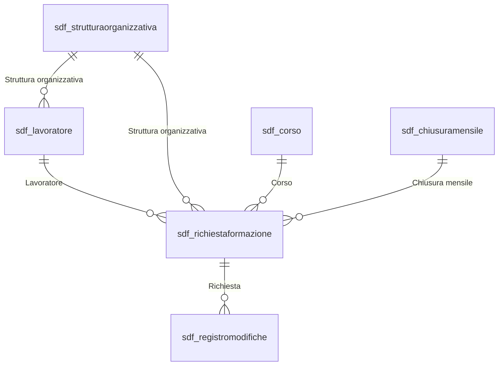

# 2. Modello dati Dataverse

> Documento generato automaticamente da `dataverse/schema.yaml` con `python dataverse/genera_documentazione.py`. Non modificarlo a mano.

- **Publisher:** Società Dolce (`societadolce`), prefisso `sdf_`, prefisso valori scelta `74150`
- **Soluzione:** Gestione ore formazione (`GestioneOreFormazione`) v1.0.0.0
- Tutte le tabelle sono di proprietà utente/team, con controllo (audit) attivo.

## Tabelle

### Strutture organizzative (`sdf_strutturaorganizzativa`)

Organigramma: un record per ogni servizio / centro di costo  
Entity set Web API: `sdf_strutture` · Nome singolare: *Struttura organizzativa*

| Nome visualizzato | Nome logico | Tipo | Dettagli |
|---|---|---|---|
| **Servizio** | `sdf_name` | Testo (200) | Colonna nome primario |
| Area | `sdf_area` | Scelta | scelta `sdf_area` (Aree); obbligatoria |
| Centro di costo | `sdf_centrodicosto` | Testo (50) | obbligatoria |
| Coordinatore responsabile | `sdf_coordinatoreresponsabile` | Ricerca | → `systemuser`; Responsabile di area / coordinatore responsabile |
| Coordinatore servizio | `sdf_coordinatoreservizio` | Ricerca | → `systemuser` |
| E-mail coordinatore servizio | `sdf_emailcoordinatoreservizio` | Testo (e-mail) |  |
| Login coordinatore servizio | `sdf_upncoordinatoreservizio` | Testo (200) | UPN Microsoft 365 del coordinatore, in minuscolo |
| Data inizio validità | `sdf_datainiziovalidita` | Solo data |  |
| Data fine validità | `sdf_datafinevalidita` | Solo data |  |
| Struttura attiva | `sdf_attiva` | Sì/No | predefinito: Sì |

### Lavoratori (`sdf_lavoratore`)

Anagrafica dei lavoratori e assegnazione organizzativa corrente  
Entity set Web API: `sdf_lavoratori` · Nome singolare: *Lavoratore*

| Nome visualizzato | Nome logico | Tipo | Dettagli |
|---|---|---|---|
| **Nominativo** | `sdf_name` | Testo (200) | Colonna nome primario |
| Utente Microsoft 365 | `sdf_utentem365` | Ricerca | → `systemuser` |
| Login Microsoft 365 | `sdf_upn` | Testo (200) | obbligatoria; UPN in minuscolo, es. mario.rossi@societadolce.it |
| Cognome | `sdf_cognome` | Testo (100) | obbligatoria |
| Nome | `sdf_nome` | Testo (100) | obbligatoria |
| E-mail aziendale | `sdf_emailaziendale` | Testo (e-mail) |  |
| E-mail di contatto | `sdf_emailcontatto` | Testo (e-mail) | Inserita dal lavoratore al primo accesso; usata per le notifiche se manca l'e-mail aziendale |
| Codice fiscale | `sdf_codicefiscale` | Testo (16) | 🔒 colonna protetta (`dati_fiscali`) |
| Codice fiscale (mascherato) | `sdf_cfmascherato` | Testo (16) |  |
| Codice fiscale registrato | `sdf_cfregistrato` | Sì/No | predefinito: No |
| Struttura organizzativa | `sdf_struttura` | Ricerca | → `sdf_strutturaorganizzativa` |
| Area | `sdf_area` | Scelta | scelta `sdf_area` (Aree) |
| Servizio | `sdf_servizio` | Testo (200) |  |
| Centro di costo | `sdf_centrodicosto` | Testo (50) |  |
| Coordinatore | `sdf_coordinatore` | Ricerca | → `systemuser` |
| Login coordinatore | `sdf_upncoordinatore` | Testo (200) |  |
| Nome coordinatore | `sdf_nomecoordinatore` | Testo (200) |  |
| E-mail coordinatore | `sdf_emailcoordinatore` | Testo (e-mail) |  |
| Stato lavoratore | `sdf_statolavoratore` | Scelta | scelta `sdf_statolavoratore` (Stati lavoratore); predefinito: Attivo |
| Data inizio validità assegnazione | `sdf_datainizioassegnazione` | Solo data |  |
| Data fine validità assegnazione | `sdf_datafineassegnazione` | Solo data |  |
| Segnalazione variazione dati | `sdf_segnalazionevariazione` | Testo multiriga (2000) | Richiesta di variazione dei dati organizzativi inviata dal lavoratore a HR |
| Segnalazione da gestire | `sdf_segnalazioneaperta` | Sì/No | predefinito: No |

Chiave alternativa **Chiave login** (`sdf_key_lavoratore_upn`): `sdf_upn`

### Catalogo corsi (`sdf_corso`)

Catalogo dei corsi aziendali e corsi esterni inseriti dai lavoratori  
Entity set Web API: `sdf_corsi` · Nome singolare: *Corso*

| Nome visualizzato | Nome logico | Tipo | Dettagli |
|---|---|---|---|
| **Titolo corso** | `sdf_name` | Testo (300) | Colonna nome primario |
| Codice univoco corso | `sdf_codicecorso` | Testo (50) | Interni: codice HR. Esterni: EXT-<progressivo> generato dall'app |
| Progressivo | `sdf_progressivo` | Testo (20) | numerazione automatica `{SEQNUM:6}` |
| Descrizione | `sdf_descrizione` | Testo multiriga (4000) |  |
| Ente erogatore | `sdf_tipoente` | Scelta | scelta `sdf_tipoente` (Tipi ente erogatore); obbligatoria; Datore di lavoro = corso interno; Committente o altro soggetto = corso esterno |
| Nome ente erogatore | `sdf_nomeente` | Testo (200) |  |
| Tipologia | `sdf_tipologia` | Testo (100) |  |
| Modalità di svolgimento | `sdf_modalita` | Scelta | scelta `sdf_modalita` (Modalità formative) |
| Durata corso (ore) | `sdf_duratacorso` | Numero decimale (2 cifre) |  |
| Gettone previsto | `sdf_gettoneprevisto` | Sì/No | predefinito: No |
| Corso attivo | `sdf_attivo` | Sì/No | predefinito: Sì |
| Più giornate formative | `sdf_piugiornate` | Sì/No | predefinito: No |
| Origine | `sdf_origine` | Scelta | scelta `sdf_originecorso` (Origini corso); predefinito: Catalogo aziendale |
| Stato validazione | `sdf_statovalidazione` | Scelta | scelta `sdf_statovalidazionecorso` (Stati validazione corso); predefinito: Validato |
| Login autore | `sdf_upnautore` | Testo (200) | Per i corsi esterni: lavoratore che li ha inseriti (storico personale) |

### Chiusure mensili (`sdf_chiusuramensile`)

Stato di apertura/chiusura dei periodi mensili e file paghe generati  
Entity set Web API: `sdf_chiusuremensili` · Nome singolare: *Chiusura mensile*

| Nome visualizzato | Nome logico | Tipo | Dettagli |
|---|---|---|---|
| **Periodo** | `sdf_name` | Testo (7) | Colonna nome primario; Formato AAAA-MM, es. 2026-10 |
| Mese | `sdf_mese` | Numero intero | obbligatoria |
| Anno | `sdf_anno` | Numero intero | obbligatoria |
| Stato del periodo | `sdf_statoperiodo` | Scelta | scelta `sdf_statoperiodo` (Stati periodo); predefinito: Aperto |
| Data chiusura | `sdf_datachiusura` | Data e ora (fuso utente) |  |
| Utente chiusura | `sdf_utentechiusura` | Ricerca | → `systemuser` |
| Numero richieste incluse | `sdf_numerorichieste` | Numero intero |  |
| Totale ore riconosciute | `sdf_totaleorericonosciute` | Numero decimale (2 cifre) |  |
| Totale gettoni | `sdf_totalegettoni` | Numero decimale (2 cifre) |  |
| File paghe generato | `sdf_filepaghegenerato` | Sì/No | predefinito: No |
| Collegamento file paghe | `sdf_urlfilepaghe` | Testo (URL) |  |
| Versione file paghe | `sdf_versionefile` | Numero intero |  |
| Note HR | `sdf_notehr` | Testo multiriga (4000) |  |
| Data riapertura | `sdf_datariapertura` | Data e ora (fuso utente) |  |
| Utente riapertura | `sdf_utenteriapertura` | Ricerca | → `systemuser` |
| Motivo riapertura | `sdf_motivoriapertura` | Testo multiriga (2000) |  |

Chiave alternativa **Chiave periodo** (`sdf_key_chiusura_periodo`): `sdf_name`

### Richieste formazione (`sdf_richiestaformazione`)

Richiesta di riconoscimento delle ore di formazione  
Entity set Web API: `sdf_richiesteformazione` · Nome singolare: *Richiesta formazione*

| Nome visualizzato | Nome logico | Tipo | Dettagli |
|---|---|---|---|
| **ID richiesta** | `sdf_name` | Testo (30) | Colonna nome primario; numerazione automatica `RF-{DATETIMEUTC:yyyy}-{SEQNUM:6}` |
| Lavoratore | `sdf_lavoratore` | Ricerca | → `sdf_lavoratore` |
| Login Microsoft 365 | `sdf_upn` | Testo (200) |  |
| Cognome | `sdf_cognome` | Testo (100) |  |
| Nome | `sdf_nome` | Testo (100) |  |
| E-mail aziendale | `sdf_emailaziendale` | Testo (e-mail) |  |
| E-mail di contatto | `sdf_emailcontatto` | Testo (e-mail) |  |
| Area | `sdf_area` | Scelta | scelta `sdf_area` (Aree) |
| Servizio | `sdf_servizio` | Testo (200) |  |
| Centro di costo | `sdf_centrodicosto` | Testo (50) |  |
| Struttura organizzativa | `sdf_struttura` | Ricerca | → `sdf_strutturaorganizzativa` |
| Coordinatore associato | `sdf_coordinatore` | Ricerca | → `systemuser` |
| Login coordinatore | `sdf_upncoordinatore` | Testo (200) |  |
| Nome coordinatore | `sdf_nomecoordinatore` | Testo (200) |  |
| E-mail coordinatore | `sdf_emailcoordinatore` | Testo (e-mail) |  |
| Corso | `sdf_corso` | Ricerca | → `sdf_corso` |
| Codice univoco corso | `sdf_codicecorso` | Testo (50) |  |
| Titolo del corso a catalogo | `sdf_titolocorso` | Testo (300) |  |
| Titolo corso libero | `sdf_titolocorsolibero` | Testo (300) |  |
| Durata complessiva corso (ore) | `sdf_duratacorso` | Numero decimale (2 cifre) |  |
| Ente erogatore | `sdf_tipoente` | Scelta | scelta `sdf_tipoente` (Tipi ente erogatore) |
| Modalità di svolgimento | `sdf_modalita` | Scelta | scelta `sdf_modalita` (Modalità formative) |
| Più giornate formative | `sdf_piugiornate` | Sì/No | predefinito: No |
| Data sessione formativa | `sdf_datasessione` | Solo data |  |
| Ora inizio sessione | `sdf_iniziosessione` | Data e ora (indipendente dal fuso) |  |
| Ora fine sessione | `sdf_finesessione` | Data e ora (indipendente dal fuso) |  |
| Durata sessione (ore) | `sdf_duratasessione` | Numero decimale (2 cifre) |  |
| Ora ingresso lavoratore | `sdf_ingresso` | Data e ora (indipendente dal fuso) |  |
| Ora uscita lavoratore | `sdf_uscita` | Data e ora (indipendente dal fuso) |  |
| Ore frequentate dichiarate | `sdf_orefrequentate` | Numero decimale (2 cifre) |  |
| Ore retribuite richieste | `sdf_oreretribuiterichieste` | Numero decimale (2 cifre) |  |
| Ore gettone richieste | `sdf_oregettonerichieste` | Numero decimale (2 cifre) |  |
| Ore retribuite riconosciute coordinatore | `sdf_oreretribuitecoord` | Numero decimale (2 cifre) | 🔒 colonna protetta (`coordinatori`) |
| Ore gettone riconosciute coordinatore | `sdf_oregettonecoord` | Numero decimale (2 cifre) | 🔒 colonna protetta (`coordinatori`) |
| Ore retribuite approvate HR | `sdf_oreretribuitehr` | Numero decimale (2 cifre) | 🔒 colonna protetta (`hr`) |
| Ore gettone approvate HR | `sdf_oregettonehr` | Numero decimale (2 cifre) | 🔒 colonna protetta (`hr`) |
| Attestato | `sdf_attestato` | File | max 10 MB |
| Altra documentazione | `sdf_altradocumentazione` | File | max 10 MB |
| Attestato presente | `sdf_attestatopresente` | Sì/No | predefinito: No |
| Note del lavoratore | `sdf_notelavoratore` | Testo multiriga (4000) |  |
| Note del coordinatore | `sdf_notecoordinatore` | Testo multiriga (4000) | 🔒 colonna protetta (`coordinatori`) |
| Note HR | `sdf_notehr` | Testo multiriga (4000) | 🔒 colonna protetta (`hr`) |
| Stato richiesta | `sdf_stato` | Scelta | scelta `sdf_statorichiesta` (Stati richiesta); obbligatoria; predefinito: Bozza |
| Data invio | `sdf_datainvio` | Data e ora (fuso utente) |  |
| Data approvazione coordinatore | `sdf_dataapprovazionecoord` | Data e ora (fuso utente) | 🔒 colonna protetta (`coordinatori`) |
| Data validazione HR | `sdf_datavalidazionehr` | Data e ora (fuso utente) | 🔒 colonna protetta (`hr`) |
| Mese di competenza | `sdf_mesecompetenza` | Numero intero |  |
| Anno di competenza | `sdf_annocompetenza` | Numero intero |  |
| Chiusura mensile | `sdf_chiusuramensile` | Ricerca | → `sdf_chiusuramensile` |
| Conferma partecipazione | `sdf_confermapartecipazione` | Sì/No | predefinito: No |
| Conferma correttezza dati | `sdf_confermacorrettezza` | Sì/No | predefinito: No |
| Autorizzazione all'invio | `sdf_autorizzazioneinvio` | Sì/No | predefinito: No |
| Possibile duplicato | `sdf_possibileduplicato` | Sì/No | predefinito: No |
| Anomalie rilevate | `sdf_anomalie` | Testo multiriga (4000) |  |
| Giorni lavorativi in attesa | `sdf_giorniattesa` | Numero intero |  |
| Sollecito segnalato a HR | `sdf_segnalatahr` | Sì/No | predefinito: No |

### Registro modifiche (`sdf_registromodifiche`)

Storico delle azioni e variazioni effettuate da lavoratori, coordinatori, HR, amministratori e flussi  
Entity set Web API: `sdf_registromodifiche` · Nome singolare: *Registro modifica*

| Nome visualizzato | Nome logico | Tipo | Dettagli |
|---|---|---|---|
| **Azione** | `sdf_name` | Testo (200) | Colonna nome primario |
| Richiesta | `sdf_richiesta` | Ricerca | → `sdf_richiestaformazione` (relazione padre-figlio) |
| Tabella | `sdf_tabella` | Testo (100) |  |
| ID record | `sdf_idrecord` | Testo (100) |  |
| Campo | `sdf_campo` | Testo (200) |  |
| Valore precedente | `sdf_valoreprecedente` | Testo multiriga (4000) |  |
| Valore nuovo | `sdf_valorenuovo` | Testo multiriga (4000) |  |
| Ruolo | `sdf_ruolo` | Scelta | scelta `sdf_ruoloapp` (Ruoli applicativi) |
| Login autore | `sdf_upnautore` | Testo (200) |  |
| Nota | `sdf_nota` | Testo multiriga (4000) |  |

## Scelte globali

### Aree (`sdf_area`)

| Valore | Etichetta |
|---|---|
| 741500000 | Area Nord Ovest |
| 741500001 | Area Centro |
| 741500002 | Area Educativa |
| 741500003 | Area Socio Sanitaria |
| 741500004 | Area Staff |

### Stati richiesta (`sdf_statorichiesta`)

| Valore | Etichetta |
|---|---|
| 741500000 | Bozza |
| 741500001 | Inviata al coordinatore |
| 741500002 | In attesa del coordinatore |
| 741500003 | Integrazione richiesta dal coordinatore |
| 741500004 | Respinta dal coordinatore |
| 741500005 | Approvata dal coordinatore |
| 741500006 | In attesa di validazione HR |
| 741500007 | Integrazione richiesta da HR |
| 741500008 | Respinta da HR |
| 741500009 | Validata da HR |
| 741500010 | Inclusa nel riepilogo mensile |
| 741500011 | Inviata a Payroll |
| 741500012 | Annullata |

### Modalità formative (`sdf_modalita`)

| Valore | Etichetta |
|---|---|
| 741500000 | In presenza |
| 741500001 | A distanza - sincrona |
| 741500002 | A distanza - asincrona |

### Tipi ente erogatore (`sdf_tipoente`)

| Valore | Etichetta |
|---|---|
| 741500000 | Datore di lavoro |
| 741500001 | Committente o altro soggetto |

### Stati periodo (`sdf_statoperiodo`)

| Valore | Etichetta |
|---|---|
| 741500000 | Aperto |
| 741500001 | Chiuso |
| 741500002 | Riaperto |

### Stati lavoratore (`sdf_statolavoratore`)

| Valore | Etichetta |
|---|---|
| 741500000 | Attivo |
| 741500001 | Non attivo |

### Origini corso (`sdf_originecorso`)

| Valore | Etichetta |
|---|---|
| 741500000 | Catalogo aziendale |
| 741500001 | Inserito dal lavoratore |

### Stati validazione corso (`sdf_statovalidazionecorso`)

| Valore | Etichetta |
|---|---|
| 741500000 | Da validare |
| 741500001 | Validato |
| 741500002 | Scartato |

### Ruoli applicativi (`sdf_ruoloapp`)

| Valore | Etichetta |
|---|---|
| 741500000 | Lavoratore |
| 741500001 | Coordinatore |
| 741500002 | Formazione HR |
| 741500003 | Amministratore |
| 741500004 | Sistema |

## Variabili d'ambiente

| Nome schema | Nome visualizzato | Valore predefinito | Note |
|---|---|---|---|
| `sdf_AppUrl` | URL app Gestione ore formazione | `https://apps.powerapps.com/play/e/<ID-AMBIENTE>/a/<ID-APP...` | URL di avvio dell'app Canvas: i flussi aggiungono &richiesta=<GUID> per il collegamento diretto |
| `sdf_EmailHR` | E-mail Ufficio HR/Formazione | `formazione@societadolce.it` |  |
| `sdf_DestinatariPayroll` | Destinatari file paghe | `paghe@societadolce.it;formazione@societadolce.it` | Indirizzi separati da punto e virgola |
| `sdf_SitoSharePointHR` | Sito SharePoint HR | `https://societadolce.sharepoint.com/sites/HR` |  |
| `sdf_CartellaPayroll` | Cartella file paghe | `/Documenti condivisi/Formazione/Payroll` |  |
| `sdf_Festivita` | Festività (JSON) | `["2026-01-01","2026-01-06","2026-04-06","2026-04-25","202...` | Giorni festivi esclusi dal conteggio dei giorni lavorativi (AAAA-MM-GG). Aggiungere il patrono locale. |

## Riferimenti di connessione

| Nome logico | Nome visualizzato | Connettore |
|---|---|---|
| `sdf_ConnDataverse` | SDF Dataverse | `shared_commondataserviceforapps` |
| `sdf_ConnOutlook` | SDF Office 365 Outlook | `shared_office365` |
| `sdf_ConnSharePoint` | SDF SharePoint | `shared_sharepointonline` |

## Ruoli di sicurezza

### SDF - Lavoratore

Lavoratore: gestisce solo le proprie richieste. I coordinatori ricevono lo stesso ruolo: l'accesso alle richieste del team arriva dalla condivisione eseguita dai flussi.

| Tabella | Crea | Leggi | Scrivi | Elimina | Aggiungi | Aggiungi a | Assegna | Condividi |
|---|---|---|---|---|---|---|---|---|
| Richieste formazione | Utente | Utente | Utente | — | Utente | Utente | — | — |
| Lavoratori | — | Utente | — | — | — | Utente | — | — |
| Catalogo corsi | Utente | Organizzazione | Utente | — | Utente | Organizzazione | — | — |
| Strutture organizzative | — | Organizzazione | — | — | — | Organizzazione | — | — |
| Chiusure mensili | — | Organizzazione | — | — | — | — | — | — |
| Registro modifiche | Utente | Utente | — | — | Utente | — | — | — |

### SDF - Formazione HR

Ufficio HR/Formazione: vede e valida tutte le richieste, chiude il mese, genera il file paghe.

| Tabella | Crea | Leggi | Scrivi | Elimina | Aggiungi | Aggiungi a | Assegna | Condividi |
|---|---|---|---|---|---|---|---|---|
| Richieste formazione | — | Organizzazione | Organizzazione | — | Organizzazione | Organizzazione | — | — |
| Lavoratori | — | Organizzazione | Organizzazione | — | Organizzazione | Organizzazione | — | — |
| Catalogo corsi | Organizzazione | Organizzazione | Organizzazione | — | Organizzazione | Organizzazione | — | — |
| Strutture organizzative | — | Organizzazione | — | — | — | Organizzazione | — | — |
| Chiusure mensili | Organizzazione | Organizzazione | Organizzazione | — | Organizzazione | Organizzazione | — | — |
| Registro modifiche | Utente | Organizzazione | — | — | Organizzazione | — | — | — |

### SDF - Amministratore

Amministratore applicativo: configurazioni, organigramma, catalogo, riapertura mesi.

| Tabella | Crea | Leggi | Scrivi | Elimina | Aggiungi | Aggiungi a | Assegna | Condividi |
|---|---|---|---|---|---|---|---|---|
| Richieste formazione | Organizzazione | Organizzazione | Organizzazione | — | Organizzazione | Organizzazione | Organizzazione | Organizzazione |
| Lavoratori | Organizzazione | Organizzazione | Organizzazione | Organizzazione | Organizzazione | Organizzazione | Organizzazione | Organizzazione |
| Catalogo corsi | Organizzazione | Organizzazione | Organizzazione | Organizzazione | Organizzazione | Organizzazione | Organizzazione | Organizzazione |
| Strutture organizzative | Organizzazione | Organizzazione | Organizzazione | Organizzazione | Organizzazione | Organizzazione | Organizzazione | Organizzazione |
| Chiusure mensili | Organizzazione | Organizzazione | Organizzazione | — | Organizzazione | Organizzazione | — | — |
| Registro modifiche | Utente | Organizzazione | — | — | Organizzazione | — | — | — |

## Profili di sicurezza delle colonne

| Gruppo di colonne | Colonne |
|---|---|
| `dati_fiscali` | Lavoratori.Codice fiscale |
| `coordinatori` | Richieste formazione.Ore retribuite riconosciute coordinatore, Richieste formazione.Ore gettone riconosciute coordinatore, Richieste formazione.Note del coordinatore, Richieste formazione.Data approvazione coordinatore |
| `hr` | Richieste formazione.Ore retribuite approvate HR, Richieste formazione.Ore gettone approvate HR, Richieste formazione.Note HR, Richieste formazione.Data validazione HR |

| Profilo | Gruppo | Lettura | Creazione | Aggiornamento |
|---|---|---|---|---|
| SDF - Lettura esiti | `coordinatori` | Sì | No | No |
| SDF - Lettura esiti | `hr` | Sì | No | No |
| SDF - Coordinatori | `coordinatori` | Sì | Sì | Sì |
| SDF - Coordinatori | `hr` | Sì | No | No |
| SDF - Formazione HR | `coordinatori` | Sì | Sì | Sì |
| SDF - Formazione HR | `hr` | Sì | Sì | Sì |
| SDF - Formazione HR | `dati_fiscali` | Sì | Sì | Sì |

## Team (gruppi Microsoft Entra ID)

| Team | Chiave in config.json | Ruoli | Profili colonne |
|---|---|---|---|
| SDF Lavoratori | `gruppo_lavoratori` | SDF - Lavoratore | SDF - Lettura esiti |
| SDF Coordinatori | `gruppo_coordinatori` | SDF - Lavoratore | SDF - Coordinatori |
| SDF Formazione HR | `gruppo_hr` | SDF - Formazione HR | SDF - Formazione HR |
| SDF Amministratori | `gruppo_amministratori` | SDF - Amministratore, SDF - Formazione HR | SDF - Formazione HR |
