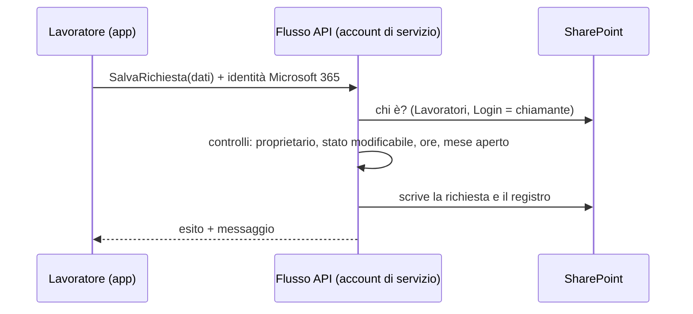

# 3. Sicurezza e protezione dei dati

## 3.1 Principio di funzionamento

SharePoint non permette di dire "questo utente vede solo le righe che lo riguardano" in modo semplice e scalabile. Per questo la soluzione adotta un modello **a sportello**:

- **lavoratori e coordinatori non hanno alcun permesso** sulle liste con dati personali (*Richieste formazione*, *Lavoratori*, *Registro modifiche*);
- tutto ciò che fanno passa dai **flussi API**, che girano con un **account di servizio** e prima di ogni operazione verificano **chi sta chiamando**. L'identità arriva dall'intestazione della chiamata Power Apps, autenticata da Microsoft 365: l'utente non può falsificarla;
- il flusso restituisce **solo** i dati che spettano a chi chiama e applica **lato server** le regole di processo (stati, ore, mese chiuso).

Anche aprendo SharePoint direttamente, un lavoratore o un coordinatore non vede le richieste altrui e non può modificare le approvazioni.

## 3.2 Livelli di protezione

| Livello | Misura |
|---|---|
| Identità | Accesso con account Microsoft 365 (SSO), con MFA e accesso condizionale secondo le policy aziendali |
| Sito | Sito del team **senza gruppo Microsoft 365** e non collegato alla intranet: nessuno vi accede se non è tra i Proprietari o nei gruppi della soluzione. Liste escluse dalla ricerca (`NoCrawl`) |
| Permessi | Proprietari (amministratori + account di servizio), gruppo *Formazione - HR* (lettura; modifica di *Lavoratori*), gruppo *Formazione - Paghe* (solo *File paghe*), "Tutti tranne gli utenti esterni" (solo *Catalogo corsi* e *Chiusure mensili*, dati non personali) |
| Logica | Flussi API con verifica del chiamante e delle regole (stati, ore, mese chiuso, coordinatore ≠ lavoratore) |
| Allegati | Raccolta *Allegati formazione* con **una cartella per coordinatore**, condivisa in sola lettura solo con lui; HR legge tutto; i lavoratori caricano tramite flusso |
| Tracciabilità | *Registro modifiche* (chi, quando, ruolo, valori prima/dopo) + **controllo versioni** di SharePoint su tutte le liste + registro di controllo di Microsoft 365 (Purview) |
| Connettori | Solo connettori standard. Consigliato un criterio DLP sull'ambiente predefinito che tenga SharePoint, Office 365 Outlook e Office 365 Users nello stesso gruppo |

## 3.3 Matrice dei permessi

| Dato | Lavoratore | Coordinatore | Formazione HR | Amministratore |
|---|---|---|---|---|
| Proprie richieste | lettura e scrittura **tramite flusso**, solo negli stati consentiti | — | — | — |
| Richieste del team | — | lettura tramite flusso; approva, respinge o chiede integrazione tramite flusso | — | — |
| Tutte le richieste | — | — | lettura diretta; validazioni tramite flusso | come HR |
| Proprio profilo (e-mail personale, CF) | lettura del CF **mascherato**; aggiornamento tramite flusso | — | lettura e modifica (CF in chiaro) | lettura e modifica |
| Anagrafica, organigramma, ruoli, configurazione | — | — | lettura (anagrafica: modifica) | modifica |
| Catalogo corsi, stato dei mesi | lettura | lettura | lettura | modifica |
| Attestati | caricamento | lettura della propria cartella | lettura | completo |
| File paghe | — | — | lettura | completo |

## 3.4 Ruoli: chi li assegna

| Ruolo | Dove si assegna | Effetto |
|---|---|---|
| Lavoratore | lista *Lavoratori* (Stato = Attivo) | può usare l'app per le proprie richieste |
| Coordinatore | lista *Lavoratori*, colonna *Coordinatore assegnato* | riceve le richieste dei lavoratori assegnati e accede alla propria cartella allegati |
| Formazione HR | lista *Ruoli applicativi* (dall'app, schermata Amministrazione) | il flusso F9 lo aggiunge al gruppo *Formazione - HR* |
| Amministratore | lista *Ruoli applicativi* | il flusso F9 lo aggiunge ai Proprietari del sito |

Il **primo** amministratore e l'account di servizio vengono inseriti dallo script di installazione.

## 3.5 Account di servizio

Le connessioni dei flussi vanno create con un account dedicato, ad esempio `svc-formazione@societadolce.it`:

- con una licenza Microsoft 365 che includa la **cassetta postale** (per inviare le e-mail), oppure con il permesso *Invia come* su una cassetta condivisa (es. `formazione@societadolce.it`, da indicare in *Configurazione → MittenteEmail*);
- **Proprietario** del sito Gestione ore formazione;
- password robusta e MFA o criteri di accesso condizionale come previsto per gli account di servizio; credenziali custodite dall'IT;
- non va usato per altro.

Se l'account viene disattivato o cambia password senza MFA compatibile, i flussi si fermano: va monitorato (Power Automate avvisa il proprietario in caso di errori ripetuti).

## 3.6 Dati personali (GDPR)

| Tema | Indicazione |
|---|---|
| Dati trattati | Nome, cognome, login, e-mail personale, codice fiscale, servizio e centro di costo, corsi frequentati, orari, ore, attestati |
| Finalità | Gestione e rendicontazione delle ore di formazione; riconoscimento economico tramite l'Ufficio Paghe; adempimenti sulla formazione obbligatoria |
| Base giuridica | Esecuzione del contratto di lavoro e obblighi di legge (art. 6.1 b, c GDPR): da confermare con il DPO |
| E-mail personale | Serve **solo** per le notifiche dell'app ai lavoratori senza casella aziendale. Indicarlo nell'informativa; il lavoratore può modificarla dal proprio profilo |
| Minimizzazione | Il CF non compare nelle richieste né nelle e-mail. È visibile in chiaro solo a HR e amministratori e nel file paghe. Il lavoratore vede la versione mascherata. Il registro non ne conserva il valore |
| Informativa | Aggiornare l'informativa ai dipendenti (art. 13) citando il nuovo strumento e l'uso dell'e-mail personale |
| Registro dei trattamenti | Aggiornare il registro (art. 30). Microsoft opera come responsabile del trattamento secondo il DPA dei servizi online; i dati restano nel tenant Microsoft 365 di Società Dolce (area UE se il tenant è in UE) |
| Conservazione | Definire i tempi per richieste, attestati e file paghe (es. allineati alla documentazione paghe) e pianificare cancellazione o archiviazione, ad esempio con i criteri di conservazione di Microsoft Purview sul sito |
| Diritti degli interessati | HR può estrarre tutte le richieste di un lavoratore (filtro per login nella lista o nel riepilogo) |
| Controllo a distanza | L'app registra azioni di processo (invii, approvazioni), non l'attività lavorativa. Verificare con il DPO e le relazioni sindacali gli aspetti dell'art. 4 L. 300/1970 |
| E-mail verso indirizzi esterni | Le notifiche ai lavoratori contengono solo il minimo (corso, data, ore, stato, link all'app) e nessun dato fiscale. I dettagli si vedono solo nell'app, dopo l'accesso |

## 3.7 Rischi residui noti

| Rischio | Mitigazione |
|---|---|
| Proprietari del sito e HR (sulla lista Lavoratori) possono modificare i dati direttamente in SharePoint, fuori dalle regole dell'app | Sono utenti di fiducia, in numero ridotto; il controllo versioni e il registro di controllo di Microsoft 365 tracciano ogni modifica |
| Gli allegati delle bozze sono già nella cartella del coordinatore | Se non è accettabile, si può modificare API03 per spostarli al momento dell'invio |
| Se l'amministratore cambia coordinatore, il precedente conserva la lettura degli allegati già caricati nella sua cartella per le richieste chiuse | F7 sposta gli allegati delle richieste aperte; quelli storici restano consultabili dal coordinatore che li ha gestiti |
| Account di servizio con privilegi elevati sul sito | Account dedicato, MFA o accesso condizionale, nessun altro uso, revisione periodica |
| Chi conosce l'URL di un file allegato non lo apre se non ha permessi | — (SharePoint verifica sempre i permessi) |
